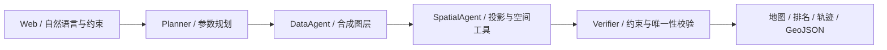

# GeoCommand

**咖啡店选址分析演示 · 可审计的 GIS 多角色工作流**

[](https://github.com/sbzz666/geocommand/actions/workflows/ci.yml)


[项目用途](#这个项目有什么用) · [快速启动](#快速启动) · [工作流](#工作流) · [测试记录](docs/validation.md) · [开发计划](#mvp-边界与后续路线)

## 这个项目有什么用？

假设你准备开一家咖啡店，希望月租不超过 20,000 元、距地铁不超过 800 米，并避开积水风险区。GeoCommand 将这些条件转换为可检查的参数，对候选铺位做空间计算，告诉你**哪些符合条件、哪些被排除，以及为什么**。

默认演示包含 12 个虚构铺位：其中 4 个符合默认条件。把月租预算改为 1,000 元，符合条件的铺位变为 0 个；取消风险区排除，可观察风险区域内铺位的变化。

这是用于学习、面试演示和后续扩展的 **GIS 工程 MVP**。当前数据全部虚构，无法用于实际商业选址；自然语言解析使用规则，尚未调用大模型。`multi` 表示分角色的确定性工作流，不代表已经实现自主 LLM 多 Agent。

使用自然语言和结构化约束筛选咖啡店铺位，展示地铁覆盖区、风险叠置、竞争点统计、候选排序和逐步执行轨迹。所有数据均为虚构演示数据，坐标位于上海附近；不是实际地铁、商铺或灾情。

## 技术栈与亮点

Python · FastAPI · Pydantic v2 · Shapely · PyProj · GeoJSON · JavaScript · SVG · pytest · Docker · GitHub Actions。

| 能力 | 实现 | 在项目中的用途 |
| --- | --- | --- |
| API 与参数校验 | FastAPI、Pydantic | 限制输入范围，提供 OpenAPI 文档 |
| 空间几何运算 | Shapely | 缓冲区、风险面覆盖、点位关系 |
| 坐标转换 | PyProj | 将经纬度转换为米制投影后计算距离 |
| 地图与结果展示 | JavaScript、SVG、GeoJSON | 点击铺位查看依据，展示覆盖区与风险区 |
| 质量验证 | pytest、合成评测脚本 | 校验边界条件和单/多角色计算一致性 |
| 交付配置 | Docker、GitHub Actions | 提供容器启动和自动测试流程 |

- **米制空间计算**：WGS84 → UTM 51N 投影后计算距离、缓冲区与面叠置，输出时转回 WGS84。
- **可解释决策**：地铁距离、租金、风险区为硬约束；竞争点密度参与软评分，每个排除结果保留原因。
- **分工与审计**：Planner → DataAgent → SpatialAgent → Verifier，使用 Pydantic 输入和结构化结果传递状态。
- **离线演示**：无 API Key、无外部地图脚本、无在线瓦片依赖；SVG 地图支持点击点位、键盘选择和 GeoJSON 导出。
- **可复现基线**：单角色使用相同规划与空间工具，多角色增加独立约束校验；公开测试与合成评测，不宣称未经验证的精度提升。

## 快速启动

需要 Python 3.12+ 和 Git。无需 GPU、模型 API Key 或地图服务 Key。

```bash
git clone https://github.com/sbzz666/geocommand.git
cd geocommand
```

Windows PowerShell：

```powershell
python -m venv .venv
.\.venv\Scripts\python.exe -m pip install -r requirements.txt
.\.venv\Scripts\python.exe -m uvicorn app.main:app --host 127.0.0.1 --port 8000
```

macOS / Linux：

```bash
python3 -m venv .venv
source .venv/bin/activate
python -m pip install -r requirements.txt
python -m uvicorn app.main:app --host 127.0.0.1 --port 8000
```

打开 http://127.0.0.1:8000，接口文档 http://127.0.0.1:8000/docs 。首次点击“开始空间分析”，即可看到12个铺位的分析。

依赖已安装的 Windows 环境也可双击 `start.cmd`，打开 http://127.0.0.1:8765 。本次本地测试结果见 [验证记录](docs/validation.md)。

```bash
docker build -t geocommand .
docker run --rm -p 127.0.0.1:8000:8000 geocommand
python -m pytest -q
python evaluate.py
```

## 示例

`寻找咖啡店，地铁500米以内，月租15000元以内，竞品半径300米。`

离线解析支持“地铁N米”“月租N元”“租金不超过N元”“竞品半径N米”。解析到的值覆盖面板对应值；编辑面板会清空自然语言输入，避免旧文本覆盖新设置。未支持的描述不会自动执行，界面显示解析边界。风险区开关以面板为准。

## 工作流



当前执行角色为确定性 Python 模块，按依赖顺序串行协作，**未接入 LLM，也不是自主多模型系统**。这里展示的是领域工具、模块职责和审计链路；后续接入 LLM 时应让模型只生成校验后的工具参数。

## 评分

`100 × (0.45 × max(0, 1-地铁米数/3000) + 0.35 × max(0, 1-月租/100000) + 0.20/(1+竞争点数量))`。

先排除不满足硬约束的铺位，再按评分降序排列。权重为演示假设；不使用不存在的人口或客流数据，不预测营业收入。距离为直线距离，不是步行路线；风险面边界点也被视为风险内。

## API

`GET /api/health`、`GET /api/layers`、`POST /api/analyze`。

```json
{
  "prompt": "地铁800米 月租20000元",
  "constraints": {
    "max_metro_m": 800,
    "max_rent": 20000,
    "competitor_radius_m": 500,
    "exclude_risk": true
  },
  "mode": "multi"
}
```

返回 `constraints`、`results`、`trace`、`geojson`、`warnings` 和耗时。输入数值及文本长度有界，不执行用户代码或 SQL，不上传数据到第三方，不持久化请求。

## 项目结构

```text
geocommand/
├── app/
│   ├── engine.py          # 示例图层、规则规划、空间工具、排序与校验
│   ├── main.py            # FastAPI 入口
│   └── static/            # 网页、SVG 地图与交互
├── tests/test_engine.py   # 几何、约束与 API 测试
├── docs/validation.md     # 实际验证结果及限制
├── evaluate.py           # 单/多角色合成用例对照
├── requirements.txt
├── Dockerfile
├── start.cmd
└── .github/workflows/ci.yml
```

## 验证与结果

本地验证：**11 项测试通过**；单角色与多角色模式各通过 **6/6 个合成用例**。这些结果只验证当前固定数据与规则，不代表真实选址准确率或多 Agent 优于单 Agent。

浏览器已验证默认筛选和预算变化。GeoJSON 后端结构通过测试，但浏览器下载落盘未验证；Docker 未在本机构建。CI 状态请以上方实时徽章为准。更多信息见 [验证记录](docs/validation.md)。

## MVP 边界与后续路线

已交付：合成数据、空间计算、可解释排序、多角色轨迹、基线、地图、导出、API、测试和容器配置。

后续：真实开放数据及许可证归档 → PostGIS 持久化/空间索引 → LLM 结构化规划 → 工具权限与恢复 → 人工标注复杂任务评测。当前没有 PostGIS、RAG、ROS2、在线商业数据或生产部署；不应在简历中声称已经具备。

验收：无密钥完成默认分析；修改预算影响候选；风险开关影响 S01；GeoJSON 包含覆盖区；API 拒绝非法输入；基线与多角色的共享计算结果一致。Docker 与 CI 为可运行配置，实际验证状态以运行记录为准。
